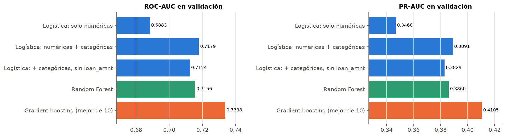
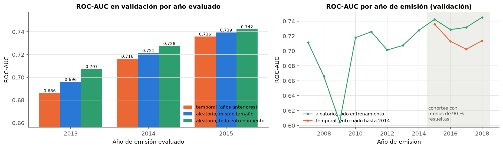

# Predicción de riesgo crediticio con datos de Lending Club

Modelo para predecir si un préstamo de Lending Club terminará en `Charged Off` usando solo información disponible al momento de evaluar la solicitud. El repositorio contiene la propuesta, la auditoría de variables, la cadena de preparación de datos (issues 2–7), el modelo final, la comprobación temporal y este informe final.

## Integrantes

- Aquino Castro, Farid Jack — 202410569
- Huaman Rosales, Jose Daniel — 202410576
- Felix Lhi, Carlos Daniel — 202120214
- Maquera Quispe, Luis Fernando — 202410621

# Informe final

## 1. Problema y datos

- **Objetivo:** predecir si un préstamo terminará en `Charged Off` (incumplimiento) usando solo la información disponible al evaluar la solicitud, antes de que Lending Club fije la tasa, la calificación y el desembolso.
- **Datos:** archivo público de préstamos aceptados de Lending Club 2007–2018 (2,260,668 préstamos y 151 columnas).
- **Población:** solo préstamos con resultado definitivo, `Fully Paid` (0) o `Charged Off` (1): **1,348,059 préstamos, 19.98 % de incumplimiento.** Se excluyen los que siguen activos (`Current`, atrasados, `Default`).
- **Partición:** 64 % entrenamiento, 16 % validación y 20 % prueba, estratificada y con semilla 42. Todo se ajusta con entrenamiento, se elige en validación y la prueba se usa una sola vez.
- **Métricas:** ROC-AUC (principal) y PR-AUC (secundaria, adecuada para el desbalance 80/20), más recall y precisión de `Charged Off` a un umbral elegido en validación.

## 2. Tratamiento de los datos

La preparación se hizo como una cadena de notebooks: cada paso parte de la salida del anterior y aprende todo solo con entrenamiento.

1. **Auditoría de variables y fuga de información.** Se revisaron las 151 columnas y se eliminaron las que solo se conocen después de aprobar el préstamo: pagos, recuperaciones, planes de dificultad y acuerdos de liquidación, y también la tasa de interés, la cuota, el `grade` y los montos financiados. El primer modelo del equipo usaba `int_rate` e `installment` y sus métricas estaban infladas por esta fuga.
2. **Base común (Issue 2).** Un solo módulo (`src/data.py`) define para todos la población, el target y la partición. Se descartaron columnas con más de 90 % de nulos, casi constantes y de texto libre (`emp_title`, `title`, `zip_code`).
3. **Columnas redundantes (Issue 3).** Se quitaron las variables casi constantes y los pares muy correlacionados (correlación de 0.90 o más), quedándose con la de menos nulos. Por ejemplo, `fico_range_high` es siempre `fico_range_low` + 4.
4. **Análisis de nulos (Issue 4).** Se comprobó si los nulos eran aleatorios (MCAR). En la mayoría no lo son: tener un dato faltante cambia la tasa de incumplimiento, en parte porque muchas columnas solo existen desde 2012 o 2016.
5. **Imputación (Issue 5).** Los nulos se rellenaron con la mediana o la moda de entrenamiento y, cuando el nulo era informativo, se añadió un indicador `<columna>_nulo` (48 indicadores).
6. **Outliers y transformaciones (Issue 6).** Recorte de valores extremos a los percentiles 1–99 (winsorización), logaritmo en las variables muy asimétricas (ingresos, saldos, conteos) y estandarización. No se eliminaron filas.
7. **Reducción de dimensión (Issue 7).** Se probó PCA con distintos números de componentes y ninguno mejoró a las variables originales, así que **no se aplica**. Tampoco se aplica LDA: con un target binario produce un solo componente.
8. **Codificación de categóricas (modelo final).** One-hot para vivienda, verificación de ingresos, propósito, estado y tipo de solicitud; `term` como indicador de 60 meses; años de empleo como número; y antigüedad del historial crediticio en meses.

Resultado: **186 variables numéricas**, sin nulos y con las mismas columnas en las tres particiones.

## 3. Modelos utilizados

| # | Modelo | Variables | Dónde | Papel |
|---|---|---|---|---|
| 1 | Regresión logística (baseline de la propuesta) | 9 numéricas | `02_baseline_sin_leakage.ipynb` | Línea base inicial |
| 2 | Regresión logística | 109 numéricas de la cadena | `issue6.ipynb`, `03_modelo_final.ipynb` | Referencia de la cadena de datos |
| 3 | Regresión logística sobre componentes PCA | 20 a 61 componentes | `issue7.ipynb` | Descartado: no mejora a las variables originales |
| 4 | Regresión logística | 186 (numéricas + categóricas) | `03_modelo_final.ipynb` | Mejor modelo lineal |
| 5 | Regresión logística sin `loan_amnt` | 185 | `03_modelo_final.ipynb` | Mide el aporte de `loan_amnt` |
| 6 | Random Forest (300 árboles) | 186 | `03_modelo_final.ipynb` | Modelo de árboles por *bagging* |
| 7 | **Gradient boosting** (`HistGradientBoostingClassifier`, búsqueda de 10 configuraciones) | 186 | `03_modelo_final.ipynb` | **Modelo final** |
| 8 | Gradient boosting sin `term`, sin `loan_amnt` y sin ambas | 184–185 | `src/ablacion_condicionales.py` | Sensibilidad a las variables condicionales |
| 9 | Gradient boosting entrenado con años anteriores | 69 sin imputar | `issue12.ipynb` | Comprobación temporal |
| — | `grade` de Lending Club | — | `03_modelo_final.ipynb` | Referencia externa, no es un modelo propio |

## 4. Comparación de modelos

**Validación** (215,690 préstamos; aquí se eligieron el modelo, los hiperparámetros y el umbral):

| Modelo | Variables | ROC-AUC | PR-AUC | Tiempo de entrenamiento |
|---|---|---|---|---|
| Baseline de la propuesta (logística) | 9 | 0.6336 | 0.2855 | segundos |
| Logística, solo numéricas | 109 | 0.6883 | 0.3468 | 2 s |
| Mejor PCA + logística | 41 componentes | 0.6871 | 0.3448 | segundos |
| Logística, sin `loan_amnt` | 185 | 0.7124 | 0.3829 | 5 s |
| Random Forest | 186 | 0.7156 | 0.3860 | 66 s |
| Logística, numéricas + categóricas | 186 | 0.7179 | 0.3891 | 6 s |
| **Gradient boosting** | 186 | **0.7338** | **0.4105** | 650 s |

**Prueba** (269,612 préstamos, evaluados una sola vez):

| Modelo | ROC-AUC | PR-AUC | Recall | Precisión |
|---|---|---|---|---|
| Baseline de la propuesta | 0.6331 | 0.2848 | 73.2 % (umbral 0.18) | 25.0 % |
| `grade` de Lending Club (referencia, no predictor) | 0.6797 | 0.3107 | — | — |
| Logística, numéricas + categóricas | 0.7185 | 0.3906 | 61.1 % | 33.9 % |
| **Gradient boosting** | **0.7354** | **0.4122** | **61.7 %** | **35.5 %** |



**Cómo se llegó de 0.633 a 0.735 de ROC-AUC:**

- Usar todas las variables preparadas en la cadena (issues 2–6), en vez de 9: +0.055.
- Añadir las categóricas codificadas (sobre todo `term`, `purpose`, `home_ownership` y `addr_state`): +0.030.
- Pasar de la logística al gradient boosting, que capta interacciones y relaciones no lineales: +0.016.

## 5. Mejor modelo: gradient boosting

**El modelo final es el gradient boosting por histogramas** (`HistGradientBoostingClassifier`, el mismo algoritmo de LightGBM) con `learning_rate` 0.03, 127 hojas por árbol, al menos 2,000 préstamos por hoja, `max_features` 0.8 y 876 árboles (early stopping).

Por qué es el mejor:

- **Es el mejor en las dos métricas**, en validación y en prueba: supera a la logística en +0.017 de ROC-AUC y +0.022 de PR-AUC, y al baseline de la propuesta en +0.102 y +0.127.
- **No sobreajustó la selección:** validación y prueba difieren en 0.002.
- **Está bien calibrado** (Brier 0.1411): una probabilidad de 0.30 corresponde a una tasa real cercana al 30 %, así que sirve tanto para ordenar el riesgo como para estimarlo.
- **Es estable en el tiempo** (sección 6): entrenado solo con préstamos hasta 2014 obtiene ROC-AUC 0.7358 en 2015.
- **Supera a la calificación `grade` de Lending Club** sobre los mismos préstamos (0.7354 frente a 0.6797). Esto no prueba que sea mejor que el proceso de Lending Club, porque `grade` tiene solo 7 niveles y el dataset no incluye las solicitudes rechazadas.

**En la práctica:** con el umbral 0.2234 (máximo F1 en validación), el modelo detecta 33,235 de los 53,864 incumplimientos de prueba (61.7 %). De cada 100 préstamos que marca como riesgosos, 35 incumplen, frente a 20 si se marcaran al azar. El umbral se puede mover según el costo de cada error.

**Alternativa:** la regresión logística con categóricas queda a 0.017 de ROC-AUC, entrena en segundos y sus coeficientes se interpretan directamente. Es una opción razonable si se prioriza la explicabilidad.

**Qué aprendió el modelo** (importancia por permutación): las variables más importantes son el plazo (`term`), el monto (`loan_amnt`), el DTI, el puntaje FICO y el ingreso anual. Todas las relaciones van en la dirección que esperaría un analista de crédito: más plazo, más monto y más DTI suben el riesgo; más FICO lo baja.

## 6. Comprobación temporal

La partición del proyecto es aleatoria, así que se comprobó si el modelo funciona al entrenarlo con el pasado y evaluarlo con el futuro (`issue12.ipynb`, con enlace para [abrirlo en Colab](https://colab.research.google.com/github/J-D-Rosales/Prediction-With-Machine-Learning-Lending-Club/blob/main/notebooks/issue12.ipynb)).

- **Madurez de las cohortes:** el 100 % de los préstamos emitidos en 2007–2013 ya tiene resultado final; en 2014, el 94.7 %; en 2015, el 89.2 %; desde 2016, menos del 70 % (11.4 % en 2018). **Corte cronológico: 2014**, el último año con al menos 90 % resuelto.
- **Prueba:** el gradient boosting entrenado solo con préstamos hasta 2014 obtiene **ROC-AUC 0.7358 en 2015**, 0.0035 menos que un modelo del mismo tamaño entrenado con una muestra aleatoria de todos los años. Al año siguiente, la pérdida está entre 0.004 y 0.010.
- **La pérdida crece con el horizonte:** 0.016 a 0.031 a 2–4 años. Conviene reentrenar el modelo cada año.



El detalle está en [`reports/decisiones_modelado.md`](reports/decisiones_modelado.md).

## 7. Limitaciones

- **`term` y `loan_amnt` son condicionales.** La propuesta solo las admite si el valor registrado ya existía antes de la aprobación, y el diccionario de Lending Club indica que `loan_amnt` puede reflejar recortes del área de crédito. Son las dos variables más importantes:

  | Gradient boosting | ROC-AUC prueba | PR-AUC prueba |
  |---|---|---|
  | Con todas las variables | 0.7354 | 0.4122 |
  | Sin `loan_amnt` | 0.7270 | 0.4015 |
  | Sin `term` | 0.7179 | 0.3859 |
  | Sin `term` ni `loan_amnt` | 0.6942 | 0.3553 |

  Si no se confirma que ambas son datos de la solicitud, 0.7354 debe leerse como cota superior. El análisis completo y las opciones están en [`reports/decisiones_columnas.md`](reports/decisiones_columnas.md#variables-condicionales-term-y-loan_amnt-modelo-final).
- **Población:** solo préstamos aprobados y con resultado definitivo. El modelo no se evaluó en solicitudes rechazadas ni en préstamos `Current`.
- **Cohortes inmaduras:** el 38.5 % de los préstamos resueltos son de 2016–2018, años en los que la mayoría de préstamos sigue activa. Los que ya se resolvieron son una submuestra sesgada (prepagos e incumplimientos tempranos).
- **Búsqueda acotada:** 10 configuraciones de gradient boosting y una de Random Forest. La interpretabilidad usa permutación y dependencia parcial en vez de SHAP, para no añadir dependencias fuera de `scikit-learn`.

## 8. Conclusiones

1. El tratamiento de los datos (eliminar la fuga, depurar redundancias, imputar con indicadores, tratar outliers y codificar categóricas) explica la mayor parte de la mejora: la logística pasa de 0.633 a 0.718 de ROC-AUC sin cambiar de algoritmo.
2. **El gradient boosting es el mejor modelo:** ROC-AUC 0.7354 y PR-AUC 0.4122 en prueba, bien calibrado y estable en el tiempo.
3. PCA y LDA no aportan con estos datos, y Random Forest no supera a la logística.
4. Antes de usarlo, el equipo debe confirmar que `term` y `loan_amnt` son datos de la solicitud, y el modelo debería reentrenarse cada año.

# Repositorio

## Notebooks por paso

| Paso | Notebook | Decisión principal |
|---|---|---|
| Auditoría de variables | [`reports/analisis_variables.md`](reports/analisis_variables.md) | 151 columnas clasificadas; se excluyen las posteriores a la aprobación (`int_rate`, `installment`, `grade`, `funded_amnt`, pagos). |
| Base común | `issue2.ipynb` | Target, población y partición compartidos (`src/data.py`). |
| Columnas redundantes | `issue3.ipynb` | Se eliminan 14 de 100 columnas: vacías, casi constantes y colineales (\|Pearson\| o \|Spearman\| ≥ 0.90). |
| Nulos MCAR | `issue4.ipynb` | La mayoría de los nulos no son MCAR (cambian la tasa de `Charged Off`); hasta 40 % de nulos se imputa, por encima se evalúa en el Issue 5. |
| Imputación | `issue5.ipynb` | Imputación con estadísticos de entrenamiento e indicadores `<columna>_nulo`. |
| Outliers y transformaciones | `issue6.ipynb` | Winsorización p1–p99, `log1p` en las asimétricas y `StandardScaler`, aprendidos con valores observados de entrenamiento. |
| PCA | `issue7.ipynb` | No se aplica: ningún número de componentes mejora a las variables originales. |
| Modelo final | `03_modelo_final.ipynb` | Codificación de categóricas, logística, Random Forest y gradient boosting; umbral, calibración, prueba e interpretabilidad. |
| Comprobación temporal | `issue12.ipynb` ([Colab](https://colab.research.google.com/github/J-D-Rosales/Prediction-With-Machine-Learning-Lending-Club/blob/main/notebooks/issue12.ipynb)) | Madurez por cohorte, corte en 2014 y prueba entrenando con años anteriores. |

Cada decisión, con sus números, está en [`reports/decisiones_columnas.md`](reports/decisiones_columnas.md) y [`reports/decisiones_modelado.md`](reports/decisiones_modelado.md). Los textos de los issues están en [`README_ISSUES.md`](README_ISSUES.md).

## Estructura del repositorio

```text
Prediction-With-Machine-Learning-Lending-Club/
├── README.md                           # Este archivo, con el informe final
├── README_ISSUES.md                    # Textos de los issues 1–14
├── proposal.md
├── requirements.txt
├── data/
│   └── Readme.md                       # Descarga de datos (no se versionan)
├── notebooks/
│   ├── 01_exploración_inicial.ipynb    # EDA y primer baseline (histórico, con fuga)
│   ├── 02_baseline_sin_leakage.ipynb   # Baseline de la propuesta (9 variables)
│   ├── issue2.ipynb … issue7.ipynb     # Cadena de preparación de datos
│   ├── 03_modelo_final.ipynb           # Modelo final
│   └── issue12.ipynb                   # Comprobación temporal por cohortes (Colab)
├── src/
│   ├── data.py                         # Base común: target, partición y columnas excluidas
│   ├── features.py                     # Redundancia y preprocesamiento numérico
│   ├── checkpoints.py                  # Guarda y carga la salida de cada issue
│   └── ablacion_condicionales.py       # Modelo final sin term / loan_amnt
└── reports/
    ├── analisis_variables.md           # Auditoría de las 151 variables
    ├── decisiones_columnas.md          # Decisiones y resultados de cada issue
    ├── decisiones_modelado.md          # Comprobación temporal (Issue 12)
    └── figures/
```

## Instalación

```bash
git clone https://github.com/J-D-Rosales/Prediction-With-Machine-Learning-Lending-Club.git
cd Prediction-With-Machine-Learning-Lending-Club
python3 -m venv venv
source venv/bin/activate          # Windows: venv\Scripts\activate
python -m pip install -r requirements.txt
```

Descarga los datos según [`data/Readme.md`](data/Readme.md). Solo hace falta `accepted_2007_to_2018Q4.csv.gz`; el archivo de rechazados se usa únicamente en la exploración inicial.

## Reproducir los resultados

Con el entorno activado, desde la raíz del repositorio:

```bash
jupyter lab
```

1. **Cadena de datos.** Ejecuta `notebooks/issue7.ipynb` (**Kernel → Restart & Run All**). Si no encuentra el checkpoint de un issue anterior, ejecuta ese notebook primero, así que basta con abrir el último. Cada issue guarda su salida en `data/checkpoints/<issue>/`. La primera lectura del CSV tarda alrededor de un minuto y deja una copia en Parquet.
2. **Modelo final.** Ejecuta `notebooks/03_modelo_final.ipynb`. Con los checkpoints tarda unos 50 minutos, casi todo en la búsqueda de hiperparámetros. Guarda el modelo en `data/modelos/modelo_final.joblib`.
3. **Comprobación temporal.** Ejecuta `notebooks/issue12.ipynb` (unos 10 minutos; no necesita checkpoints). También corre en Google Colab con el enlace de la tabla anterior: clona el repositorio y descarga los datos con `kagglehub`.
4. **Variables condicionales (opcional).** `python -m src.ablacion_condicionales` reentrena el gradient boosting sin `term`, sin `loan_amnt` y sin ambas (unos 20 minutos).

`notebooks/02_baseline_sin_leakage.ipynb` es independiente de la cadena y reproduce el baseline de la propuesta. `notebooks/01_exploración_inicial.ipynb` conserva el EDA y el primer baseline del equipo, que usaba `int_rate` e `installment` (variables posteriores a la aprobación); sus métricas no son comparables con el modelo final. Para ejecutarlo se necesitan también los rechazados y lanzar Jupyter desde `notebooks/` con `PYTHONPATH=..`.
